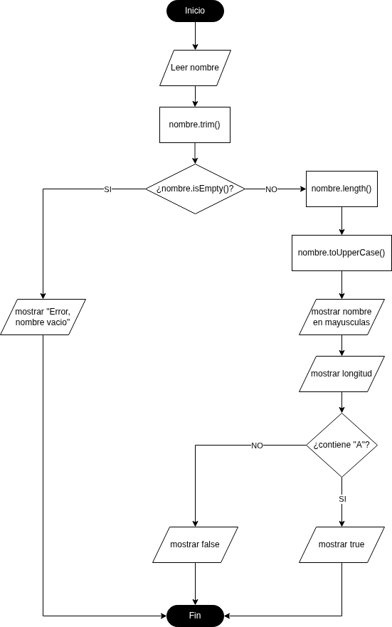
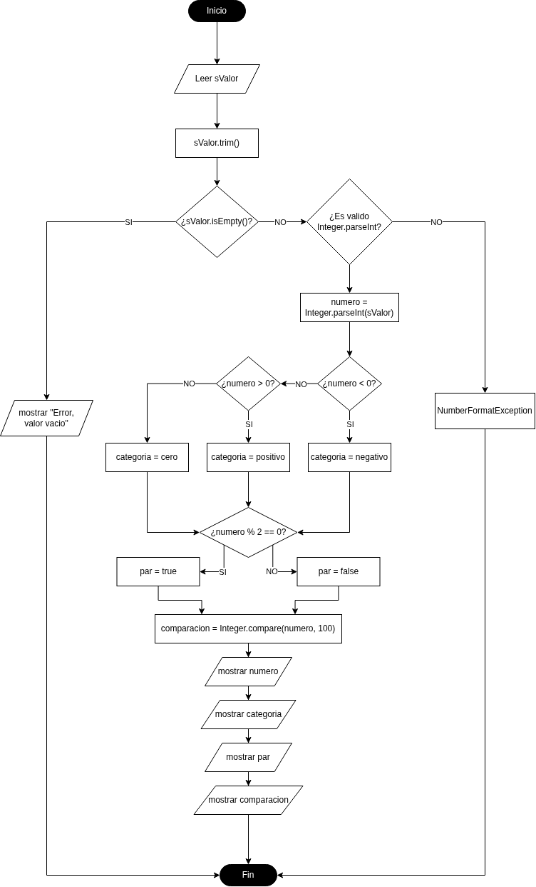
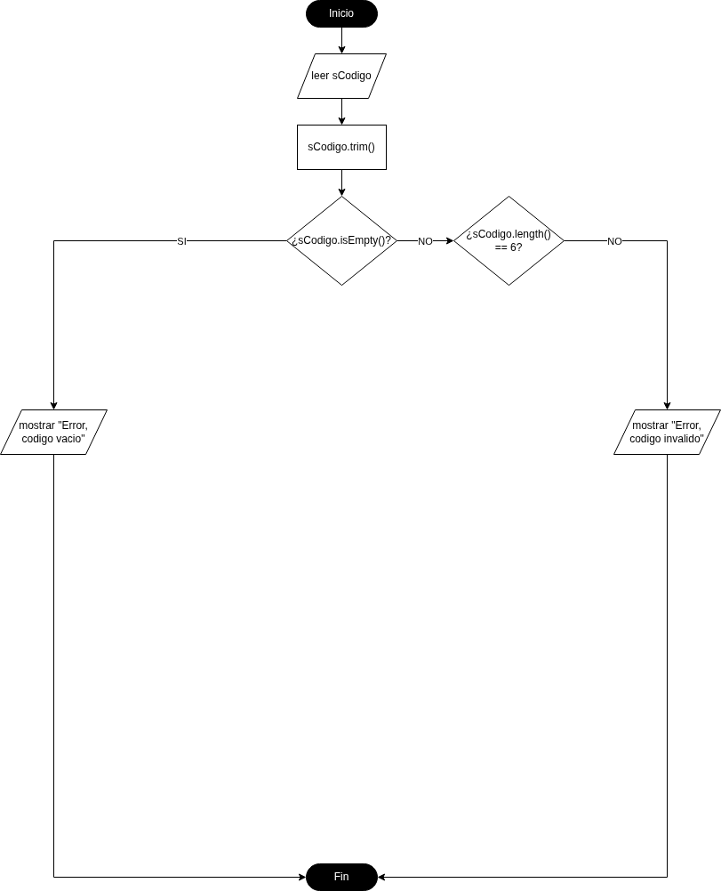

# Tarea 1 — Diagramas de flujo con `String` e `Integer`

**Módulo:** Entornos de Desarrollo (DAM)  
**Unidad 5:** Elaboración de diagramas de comportamiento  
**Herramienta obligatoria:** [diagrams.io / draw.io](https://app.diagrams.net/)  
**Entrega:** enlace público al repositorio de GitHub `tarea-1`  
**Calificación:** 10 puntos (ejercicio 1: 2; ejercicio 2: 4; ejercicio 3: 4)

## 1. Objetivos

Diseñar algoritmos mediante **diagramas de flujo**, utilizando operaciones de las clases Java `String` e `Integer`. Se evaluará la lógica del algoritmo y su representación gráfica; **no se pide programarlo en Java**.

Al terminar deberás saber representar entradas y salidas, transformaciones de datos, decisiones, bucles y validación de errores, así como explicar y comprobar manualmente un algoritmo.

## 2. Elementos del diagrama de flujo que utilizaremos

Selecciona en diagrams.io las figuras de **Flowchart / Diagrama de flujo**. Emplea los siguientes símbolos de manera coherente:

| Símbolo | Nombre | Para qué se utiliza | Ejemplo |
| --- | --- | --- | --- |
| Óvalo o rectángulo redondeado | **Inicio / fin (terminal)** | Marcar dónde comienza y termina el algoritmo | `Inicio`, `Fin` |
| Paralelogramo | **Entrada / salida** | Leer datos o mostrar resultados | `Leer nombre`, `Mostrar resultado` |
| Rectángulo | **Proceso** | Asignar valores, calcular y aplicar métodos | `nombre = nombre.trim()` |
| Rombo | **Decisión** | Evaluar una condición y bifurcar el recorrido | `¿nombre.isEmpty()?` |
| Flecha | **Línea de flujo** | Indicar el orden y el sentido de ejecución | De una lectura a un proceso |

**Normas de dibujo:**

- Utiliza flechas para conectar las figuras; evita conexiones ambiguas o cruces innecesarios.
- Rotula las ramas de los rombos con **Sí** y **No**.
- Representa las repeticiones mediante una decisión y una flecha que vuelve a un paso anterior.
- Incluye el tratamiento de entradas no válidas y un final alcanzable en todos los recorridos.
- Escribe el nombre exacto de los métodos Java cuando se soliciten.
- Utiliza un tamaño de letra legible y organiza preferentemente el flujo de arriba abajo.

## 3. Herramienta y formato de los archivos

**Todos los diagramas se realizarán en [diagrams.io](https://app.diagrams.net/).** Al guardar/exportar cada uno, utiliza **Archivo → Exportar como → PNG** y activa la opción **«Incluir una copia de mi diagrama» / «Include a copy of my diagram»** (su nombre puede variar según el idioma o la versión). De esta manera el PNG conservará los datos del diagrama para reabrirlo y editarlo en diagrams.io.

Guarda los archivos con estos nombres exactos: `ejercicio-1.drawio.png`, `ejercicio-2.drawio.png`, `ejercicio-3.drawio.png`.

> Una captura de pantalla o un PNG normal **no** sustituye a un `.drawio.png` editable. Comprueba cada archivo abriéndolo de nuevo en diagrams.io.

## 4. Ejercicio 1 — Analizador de nombres (2 puntos)

### Enunciado

Diseña un algoritmo que solicite un nombre completo, lo normalice y muestre el nombre en mayúsculas, su longitud y si contiene la letra **a**, sin distinguir mayúsculas y minúsculas.

El algoritmo debe:

1. Leer el nombre completo como `String`.
2. Eliminar los espacios al principio y al final mediante `trim()`.
3. Comprobar si está vacío mediante `isEmpty()`. Si es así, mostrar un mensaje de error y finalizar.
4. Calcular su longitud con `length()` (contando los espacios interiores).
5. Transformarlo a mayúsculas con `toUpperCase()`.
6. Comprobar la presencia de la letra `a` mediante `toLowerCase()` y `contains("a")`.
7. Mostrar el nombre transformado, su longitud y el resultado de la comprobación.

### Definición del algoritmo (ejemplo resuelto)

- **Entrada:** `nombre` (`String`).
- **Procesos:** `trim()`, `length()`, `toUpperCase()`, `toLowerCase()` y `contains("a")`.
- **Decisiones:** ¿está vacío el nombre?; ¿contiene la letra `a`?
- **Salidas:** error si el nombre está vacío; en caso contrario, nombre en mayúsculas, número de caracteres y mensaje Sí/No.

### Diagrama resuelto de referencia



**Tu tarea con el ejercicio 1:** utiliza este dibujo como guía, **reconstrúyelo en diagrams.io**, guarda/exporta tu propia versión editable con el nombre `diagramas/ejercicio-1.drawio.png` y comprueba que incluye todas las ramas. No basta con subir la imagen proporcionada sin recrear el diagrama.

**Pruebas de ejemplo:**

| Entrada | Salida esperada |
| --- | --- |
| `"  Ana García  "` | `ANA GARCÍA`; longitud `10`; contiene `a`: **Sí** |
| `"Luis"` | `LUIS`; longitud `4`; contiene `a`: **No** |
| `"   "` | Mensaje de error: nombre vacío |

## 5. Ejercicio 2 — Validador y clasificador de números (4 puntos)

### Enunciado

Diseña **por tu cuenta** un algoritmo que reciba un entero como texto, valide la entrada, la convierta y muestre su clasificación.

**Requisitos obligatorios:**

1. Leer un valor como `String` y quitar los espacios exteriores mediante `trim()`.
2. Detectar la cadena vacía con `isEmpty()` y mostrar un error si procede.
3. Verificar que el texto representa un entero válido en el rango de `int`; si no, mostrar un error y finalizar. Puedes representar este control como una decisión «¿se puede convertir con `Integer.parseInt()`?»; en Java los errores de conversión provocan `NumberFormatException`.
4. Convertir el texto con `Integer.parseInt()`.
5. Determinar si el número es positivo, negativo o cero.
6. Determinar si es par o impar usando `% 2` (el cero es par).
7. Compararlo con `100` mediante `Integer.compare(numero, 100)`.
8. Mostrar el número convertido y las tres clasificaciones.

**Métodos obligatorios:** `trim()`, `isEmpty()`, `Integer.parseInt()` e `Integer.compare()`.

### Qué debes construir

En este `README.md`, **debajo de este apartado**, escribe tu propia **definición del algoritmo**, identificando entrada, procesos, decisiones, salidas y tratamiento de errores. Construye el diagrama en diagrams.io y guárdalo como `diagramas/ejercicio-2.drawio.png`. Inserta después esta imagen en el README usando Markdown:

```markdown

```

**Pruebas mínimas que debes documentar:** `" 42 "`, `"-7"`, `"0"` y `"hola"` (además de cualquier caso adicional que consideres necesario). Escribe para cada entrada la salida esperada y contrástala siguiendo tu diagrama.

**Ejemplo:** para `" 42 "` se mostrará: número `42`, **positivo**, **par** y **menor que 100**.

## 6. Ejercicio 3 — Analizador de códigos numéricos (4 puntos)

### Enunciado

Diseña **por tu cuenta** un algoritmo que lea un código de **exactamente seis dígitos**, mantenga los posibles ceros iniciales y calcule la suma de sus dígitos, el mayor dígito y la paridad de la suma.

**Requisitos obligatorios:**

1. Leer el código como `String` y aplicar `trim()`.
2. Comprobar que `length()` devuelve exactamente `6`; si no, mostrar un error y finalizar.
3. Recorrer los seis caracteres mediante un bucle con índice de `0` a `5`.
4. Extraer cada dígito mediante `substring(i, i + 1)`.
5. Comprobar que cada fragmento representa un dígito del `0` al `9`. Si no, mostrar un error y finalizar; puedes comprobarlo antes de convertir o gestionar el error de `Integer.parseInt()`.
6. Convertir el fragmento mediante `Integer.parseInt()`.
7. Acumular la suma de los dígitos y actualizar el mayor mediante `Integer.max()`.
8. Determinar si la suma es par o impar mediante `% 2`.
9. Mostrar el código original, la suma, el mayor dígito y la paridad de la suma.

**Métodos obligatorios:** `trim()`, `length()`, `substring()`, `Integer.parseInt()` e `Integer.max()`.

**Importante:** conserva el código completo como `String`; si lo transformas a `int`, se perderían los ceros iniciales.

### Qué debes construir

En este `README.md`, **debajo de este apartado**, escribe tu propia **definición del algoritmo**, identificando entrada, procesos, decisiones, salidas, variables del bucle y tratamiento de errores. Construye el diagrama en diagrams.io y guárdalo como `diagramas/ejercicio-3.drawio.png`. Inserta después esta imagen en el README usando Markdown:

```markdown

```

**Pruebas mínimas que debes documentar:** `"204816"`, `"002315"`, `"123"` y `"12A456"`. Para cada una indica la salida esperada y explica por qué se acepta o rechaza.

**Ejemplo:** para `"204816"` la suma es `21`, el mayor dígito es `8` y la suma es **impar**.

## 7. Organización obligatoria del repositorio

Crea en GitHub un repositorio **público** llamado exactamente `tarea-1`. La estructura final será:

```text
tarea-1/
├── README.md
└── diagramas/
    ├── ejercicio-1.drawio.png
    ├── ejercicio-2.drawio.png
    └── ejercicio-3.drawio.png
```

**Solo habrá un archivo Markdown:** `README.md`. En él deben aparecer los **tres enunciados**, la definición de los tres algoritmos, las imágenes de los tres diagramas y las pruebas manuales. No se admitirán archivos `ejercicio-1.md`, `ejercicio-2.md` o `ejercicio-3.md` independientes. La carpeta `diagramas/` contendrá los **tres archivos `.drawio.png` editables**.

Al comenzar recibirás el `README.md` y el ejemplo del primer diagrama. Tendrás que reconstruir el primero y crear los otros dos, completar las definiciones y las pruebas en el propio README, y publicar los cambios en GitHub.

## 8. Publicación y entrega

Puedes trabajar desde IntelliJ IDEA o desde una terminal, pero los diagramas se crearán en diagrams.io. Una vez preparados los archivos en tu carpeta local `tarea-1`, publícalos con Git:

```bash
git status
git add README.md diagramas/
git commit -m "docs: completar tarea 1 de diagramas de flujo"
git push origin main
```

Antes de entregar, entra en GitHub y comprueba que los tres PNG se ven correctamente, que las tres definiciones están escritas y que puedes abrir los PNG para editarlos en diagrams.io.

**La entrega en el aula virtual será exclusivamente la URL pública del repositorio**, con este formato:

```text
https://github.com/TU_USUARIO/ets-dam/unidad-2/tarea-1
```

No se entrega un PDF ni un ZIP en el aula virtual.

## 9. Rúbrica de evaluación

| Ejercicio | Criterios | Puntos |
| --- | --- | ---: |
| **1. Analizador de nombres** | Definición y reconstrucción correcta del diagrama de referencia; símbolos, ramas y archivo editable | **2,0** |
| **2. Validador de enteros** | Definición del algoritmo (1), validación y decisiones (1), diagrama correcto (1,5), pruebas y archivo editable (0,5) | **4,0** |
| **3. Analizador de códigos** | Definición del algoritmo (1), bucle y tratamiento de errores (1), diagrama correcto (1,5), pruebas y archivo editable (0,5) | **4,0** |
| **Total** | | **10,0** |

> Se comprobará la correspondencia entre la definición escrita en `README.md`, la lógica representada y el archivo `.drawio.png` editable. La publicación en el repositorio indicado forma parte de la entrega obligatoria.
