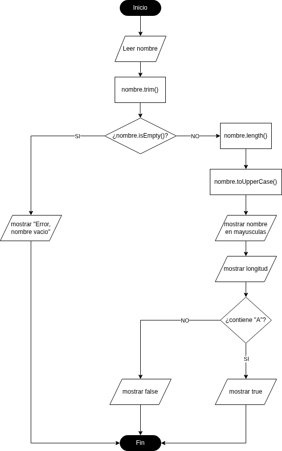
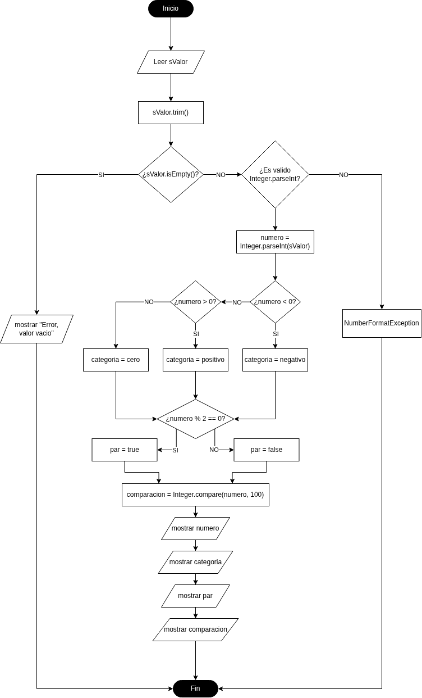
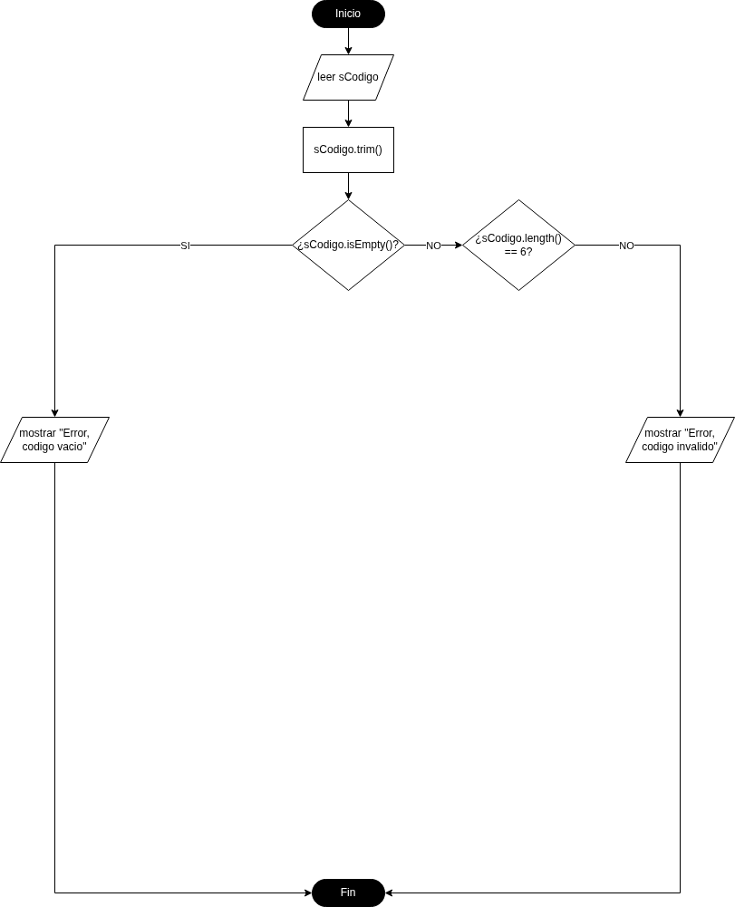

# Tarea 1 — Solución de ejemplo: diagramas de flujo con `String` e `Integer`

**Módulo:** Entornos de Desarrollo (DAM)  
**Unidad 5:** Elaboración de diagramas de comportamiento  
**Herramienta:** [diagrams.io](https://app.diagrams.net/)  
**Repositorio público:** `tarea-1`  
**Autor/a:** Nombre Apellidos  

> **Modelo orientativo de entrega del alumnado.** Esta es una solución completa de referencia. Los diagramas se han guardado en `diagramas/` con formato `.drawio.png` para visualizarlos en GitHub y reabrirlos en diagrams.io.

## 1. Objetivo

Representar mediante diagramas de flujo tres algoritmos que utilizan operaciones de las clases Java `String` e `Integer`. Para cada uno se describen **entrada, procesos, decisiones, salidas y tratamiento de errores**, se incluye el **diagrama** y se documentan **pruebas manuales**. No se requiere escribir un programa Java.

## 2. Símbolos empleados

| Símbolo de diagrams.io | Función | Ejemplo |
| --- | --- | --- |
| **Óvalo** (terminal) | Inicio o fin | `Inicio`, `Fin` |
| **Paralelogramo** | Entrada o salida | `Leer nombre`, `Mostrar resultado` |
| **Rectángulo** | Proceso o asignación | `suma = suma + digito` |
| **Rombo** | Decisión con ramas **Sí** / **No** | `¿n % 2 == 0?` |
| **Flecha** | Sentido de ejecución, incluido el retorno de bucles | Volver a comprobar `i < 6` |

## 3. Ejercicio 1 — Analizador de nombres (2 puntos)

### Enunciado

Solicitar el nombre completo del usuario como cadena de texto. Eliminar espacios al principio y al final, comprobar que el nombre no esté vacío y, si es válido, mostrarlo en mayúsculas, indicar su longitud y comprobar si contiene la letra `a` sin distinguir entre mayúsculas y minúsculas.

### Definición del algoritmo

- **Entrada:** `nombre` (`String`).
- **Procesos:** `nombre = nombre.trim()`; `longitud = nombre.length()`; `mayusculas = nombre.toUpperCase()`; `contieneA = nombre.toLowerCase().contains("a")`.
- **Decisiones:** `nombre.isEmpty()` y `contieneA`.
- **Salidas:** mensaje de error si la cadena está vacía o, de lo contrario, nombre en mayúsculas, longitud y mensaje de presencia de `a`.
- **Tratamiento de errores:** si la entrada es vacía o solo contiene espacios, mostrar error y terminar sin efectuar el resto de operaciones.

### Diagrama de flujo



### Pruebas manuales

| Entrada | Resultado esperado | Comprobación |
| --- | --- | --- |
| `"  Ana García  "` | `ANA GARCÍA`; longitud `10`; contiene `a`: **Sí** | Correcto: se eliminan espacios exteriores, no el espacio interior. |
| `"Luis"` | `LUIS`; longitud `4`; contiene `a`: **No** | Correcto. |
| `"   "` | Error: nombre vacío | Correcto: `trim()` produce una cadena vacía. |

## 4. Ejercicio 2 — Validador y clasificador de números (4 puntos)

### Enunciado

Leer un número entero como `String`, eliminar espacios exteriores, validar que representa un entero en el rango del tipo `int`, convertirlo con `Integer.parseInt()` y mostrar si es positivo, negativo o cero; par o impar; y menor, igual o mayor que 100 usando `Integer.compare()`.

### Definición del algoritmo

- **Entrada:** `texto` (`String`).
- **Procesos:** limpiar con `trim()`; convertir con `Integer.parseInt()`; calcular `n % 2`; comparar mediante `Integer.compare(n, 100)`.
- **Decisiones:** ¿cadena vacía?; ¿puede convertirse a `int`?; ¿`n > 0`?; si no, ¿`n < 0`?; ¿`n % 2 == 0`?; ¿resultado de comparar menor, igual o mayor que cero?
- **Salidas:** número convertido, signo, paridad y comparación con 100; o un mensaje de error.
- **Tratamiento de errores:** si la cadena está vacía, contiene letras, decimales o un número fuera del rango de `int`, mostrar error y finalizar. La decisión «¿`Integer.parseInt(texto)` es válido?» representa la gestión de `NumberFormatException`.

### Desarrollo lógico

1. Leer `texto`, aplicar `trim()` y detenerse si `isEmpty()` es verdadero.
2. Comprobar que `Integer.parseInt(texto)` puede ejecutarse sin error; si falla, terminar con un mensaje.
3. Guardar el valor convertido en `n`.
4. Clasificar el signo: `n > 0` es **positivo**; `n < 0` es **negativo**; si ninguna se cumple, es **cero**.
5. Calcular `n % 2`: si el resto es cero, es **par**; de lo contrario, **impar**.
6. Guardar `comparacion = Integer.compare(n, 100)`: negativo significa menor que 100, cero significa igual y positivo significa mayor.
7. Mostrar todos los resultados y terminar.

### Diagrama de flujo



### Pruebas manuales

| Entrada | Resultado esperado | Comprobación |
| --- | --- | --- |
| `" 42 "` | `42`; **positivo**; **par**; **menor que 100** | Correcto. |
| `"-7"` | `-7`; **negativo**; **impar**; **menor que 100** | Correcto. |
| `"0"` | `0`; **cero**; **par**; **menor que 100** | Correcto: cero es par. |
| `"100"` | `100`; **positivo**; **par**; **igual a 100** | Correcto. |
| `"hola"` | Error: no es un entero válido | Correcto: no debe continuarse con la conversión. |
| `"2147483648"` | Error: fuera del rango de `int` | Correcto: supera el máximo de un `int`. |

## 5. Ejercicio 3 — Analizador de códigos numéricos (4 puntos)

### Enunciado

Leer un código de exactamente seis dígitos como `String`, respetando los ceros iniciales. Recorrer sus caracteres, convertir cada dígito a `int` con `Integer.parseInt()`, calcular la suma total, localizar el mayor con `Integer.max()` e indicar si la suma es par o impar.

### Definición del algoritmo

- **Entrada:** `codigo` (`String`).
- **Variables de trabajo:** `i` (índice), `caracter` (`String`), `digito` (`int`), `suma` (`int`), `mayor` (`int`) y `paridad` (`String`).
- **Inicialización:** `suma = 0`, `mayor = 0`, `i = 0`.
- **Procesos del bucle:** `caracter = codigo.substring(i, i + 1)`; validar `0`–`9`; `digito = Integer.parseInt(caracter)`; `suma = suma + digito`; `mayor = Integer.max(mayor, digito)`; `i = i + 1`.
- **Decisiones:** ¿longitud exactamente 6?; ¿`i < 6`?; ¿carácter numérico?; ¿`suma % 2 == 0`?
- **Salidas:** código original (con ceros iniciales), suma, dígito mayor y paridad; o mensaje de error.
- **Tratamiento de errores:** si la longitud no es seis o alguno de los caracteres no es un dígito entre `0` y `9`, mostrar error y finalizar. El código completo nunca se convierte a `int`.

### Desarrollo lógico

1. Leer el código y aplicar `trim()`.
2. Validar `codigo.length() == 6`; si no, mostrar error y terminar.
3. Inicializar `suma = 0`, `mayor = 0` e `i = 0`.
4. Mientras `i < 6`, extraer `codigo.substring(i, i + 1)` y verificar que el carácter esté entre `"0"` y `"9"`.
5. Convertir el carácter con `Integer.parseInt()`, acumularlo en `suma`, actualizar `mayor` mediante `Integer.max()` e incrementar `i`.
6. Cuando el bucle termina, determinar la paridad de `suma` con `% 2`.
7. Mostrar código, suma, mayor y paridad.

### Diagrama de flujo



### Pruebas manuales

| Entrada | Resultado esperado | Comprobación |
| --- | --- | --- |
| `"204816"` | Código `204816`; suma `21`; mayor `8`; **impar** | `2 + 0 + 4 + 8 + 1 + 6 = 21`. |
| `"002315"` | Código `002315`; suma `11`; mayor `5`; **impar** | Conserva los dos ceros iniciales. |
| `"000000"` | Código `000000`; suma `0`; mayor `0`; **par** | Correcto. |
| `"123"` | Error: longitud distinta de seis | Correcto. |
| `"12A456"` | Error: código no numérico | Correcto: la letra `A` no es un dígito. |

## 6. Estructura del repositorio

```text
tarea-1/
├── README.md
└── diagramas/
    ├── ejercicio-1.drawio.png
    ├── ejercicio-2.drawio.png
    └── ejercicio-3.drawio.png
```

Todos los diagramas deben poder verse desde GitHub y abrirse de nuevo con [diagrams.io](https://app.diagrams.net/) para modificarlos. Solo existe **un archivo Markdown**: este `README.md`.

## 7. Entrega

Se entrega en el aula virtual **únicamente el enlace público del repositorio**:

```text
https://github.com/TU_USUARIO/ets-dam/unidad-2/tarea-1
```

**Puntuación:** ejercicio 1 = **2 puntos**; ejercicio 2 = **4 puntos**; ejercicio 3 = **4 puntos**. **Total: 10 puntos**.
